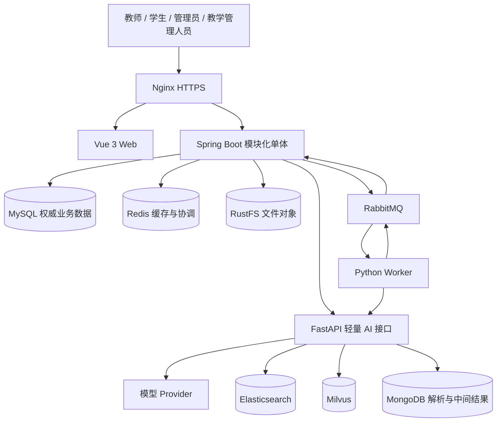
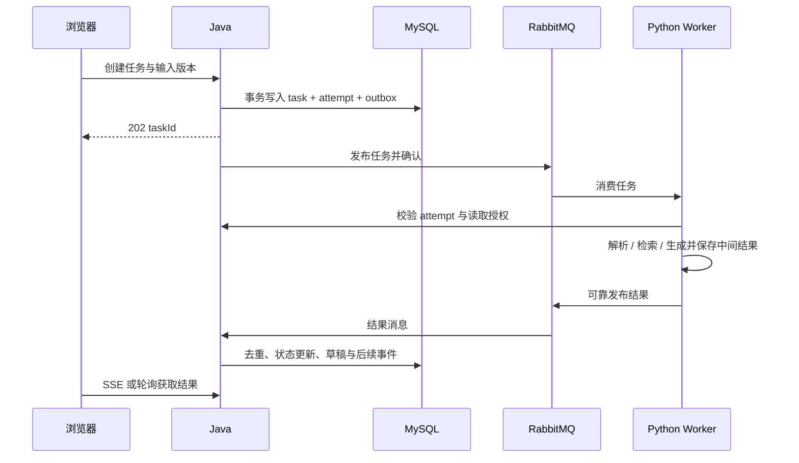

# EduNexus AI 软件设计文档

版本：V1.0 设计草案

日期：2026-11-10

需求依据：[PRD.md](PRD.md)；本地总体设计基线 `docs/EduNexus_AI.md`。

## 1. 设计范围与状态

本文面向开发、测试和部署，描述模块边界、逻辑数据模型、接口契约、核心流程、安全及运维设计。九个业务模块及七类 AI 工具均在目标范围内，按 PRD 五阶段交付。

Vue、Java/Python 分工、MySQL、RabbitMQ、RustFS 等为已确认基线。身份与上传规则已于 2026-11-11 确认，详见[第 1 阶段身份与上传规则决策](decisions/phase-1-rules.md)，作为第 1 阶段实现与测试约束，不表示业务功能已实现。本文中的目录、表名、接口路径、消息结构和状态细化是建议设计，供实施时评审；尚未启用组件的精确版本、容量、考试策略及模型供应商仍按对应阶段确认，不擅自设定未确认的数值承诺。

## 2. 系统架构



前端业务请求统一进入 Java；Python 接口及 Worker 仅内部访问。Java 管理身份、授权、正式资源和任务主状态；Python 执行解析、切片、Embedding、检索和模型生成。图中 Python 读取文件及获得授权候选集的过程通过 Java 内部授权接口完成，不绕过业务权限。

常规操作同步返回；批量解析、内容生成、导出等长任务异步执行。快速问答可以同步或流式返回，但调用前和结果返回前均须执行授权检查。

## 3. 工程与模块边界

建议目录：

```text
frontend/src/
  app/                  # 路由、布局、全局配置
  modules/              # 按业务域划分页面、API、类型、组件
  shared/               # 通用组件、HTTP、错误及权限显示
backend/
  user/ organization/ resource/ ai/ course/
  teaching-resource/ teaching-learning/ interaction/ analytics/ system/
  shared/               # 技术基础设施，不依赖具体业务模块
ai-service/
  api/ workers/ providers/ parsers/ retrieval/ workflows/ schemas/
deploy/                 # Compose、Nginx、配置模板和运维说明
docs/                   # 接口、数据、测试及决策记录
```

后端模块名表示业务边界，不强制每个都是独立构建产物。普通模块采用 Controller → Service → Mapper；复杂模块采用 interfaces → application → domain，infrastructure 实现领域定义的持久化和外部能力接口。Controller 不写 SQL、不调用模型 SDK。

| 模块 | 拥有的数据与职责 | 对外能力 | 对应需求 |
| --- | --- | --- | --- |
| user / organization | 账号、会话、角色、组织、身份审核 | 身份查询、操作权限、数据范围判定 | FR-01 |
| resource | 文件、版本、分类、共享及文件授权 | 文件访问、资源引用、版本查询 | FR-02 |
| ai | 模型配置、任务、尝试记录、调用记录 | 创建任务、执行授权、结果接收 | FR-03、04 |
| course | 课程、成员、加入申请、邀请码 | 成员和课程管理资格查询 | FR-05 |
| teaching-resource | 知识点、题目、审核、发布 | 正式资源、题目版本和发布范围查询 | FR-06 |
| teaching-learning | 计划、作业考试、试卷快照、答卷、成绩 | 作答、批改、公布和成绩事件 | FR-07 |
| interaction | 讨论、问答、公告、通知及接收状态 | 课程互动和消息投递 | FR-08 |
| analytics | 学习事件、派生统计、分析查询 | 授权汇总及个人分析 | FR-09 |
| system | 参数、运行管理、审计查询 | 配置、监控、审计入口 | FR-10 |

每张表由一个模块写入。跨模块只调用公开应用服务、查询接口或发布事件，禁止直接调用对方 Mapper/Repository 和修改其业务表。跨模块流程由应用层编排；后续索引、通知和统计通过可靠事件驱动。

## 4. 身份与授权设计

授权输入为 actorId、action、resourceId、组织范围、课程关系、资源版本及发布状态。服务端按以下顺序判定：账号及会话有效 → 操作角色许可 → 组织/课程资格 → 资源归属或显式共享 → 状态允许。默认拒绝，管理员无私人正文读取特权。

列表查询先限定候选范围，单项读取、下载、导出及 AI 处理再次授权。用户提交的 ownerId、departmentId、courseId 只作为请求数据，必须与权威关系核对，不能直接变成查询授权条件。资源 ID 不可预测也不能代替授权。

访问令牌采用 JWT；服务端保存可撤销会话状态或会话版本，确保停用和权限变更及时生效。刷新令牌使用安全随机值，服务端只存哈希，轮换时以原子操作使旧值失效并检测复用。建议浏览器采用 Secure、HttpOnly Cookie 保存刷新令牌，访问令牌仅保存在内存；Cookie 参与认证的接口配置 SameSite 和 CSRF 防护。有效期和跨域部署策略待确认。

权限缓存须有短时有效期和变更失效机制；严格撤权场景回源校验。审计记录操作者、动作、目标、时间、结果和 traceId，避免保存密码、令牌和私密正文。

## 5. 逻辑数据模型

下表是建议逻辑表，不是最终 DDL。主键统一使用一种全局 ID 方案并以字符串传给前端，避免 JavaScript 整数精度问题。时间以 UTC 存储和传输，界面按用户时区展示。金额之外的分数也使用定点数，不以浮点数累计成绩。

| 数据域 | 建议实体 / 关键字段 | 约束与索引 |
| --- | --- | --- |
| 身份 | user、role、permission、user_role、role_permission、session、identity_application | 登录标识唯一；会话 token_hash 唯一；账号状态和版本可审计 |
| 组织 | organization(id,parent_id,type)、user_organization | 组织树防环；成员关联唯一；组织类型覆盖学校院系专业年级班级 |
| 文件 | file_asset(owner_id,status)、file_version(asset_id,version_no,object_key,checksum,size,mime)、resource_grant | 版本号与 asset_id 联合唯一；对象键唯一；授权按主体、范围和资源建立索引 |
| 课程 | course、course_member、course_join_application、course_invitation | course_id + user_id 成员唯一；邀请凭据存哈希；申请并发处理有版本控制 |
| 教学资源 | teaching_resource、knowledge_point、question、question_version、review_record、publication | 题目版本不可变；资源关联来源版本；审核保存对象版本和意见 |
| AI | ai_task、ai_task_attempt、ai_result、model_config、model_call_log | task_id + attempt_no 唯一；结果按任务与尝试去重；配置保存密钥引用 |
| 教学活动 | learning_plan、assessment、paper_version、paper_item、submission、answer、grade_revision | 答卷按活动、学生及允许尝试次数唯一；paper_item 固定题干选项答案解析及分值快照 |
| 互动 | discussion、reply、course_question、announcement、notification、notification_recipient | 接收人 + 通知唯一；read_at 记录个人已读；查询按课程和可见范围过滤 |
| 分析 | learning_event、analytics_projection | 事件 ID 去重；派生统计保存口径版本、统计窗口和更新时间 |
| 可靠性 | outbox_event、consumed_event、audit_log | 消费者名 + event_id 唯一；Outbox 按状态和下次投递时间索引 |

通用字段建议包含 created_at、updated_at、version；需要软删除的对象显式定义 deleted_at 及唯一约束冲突处理，不默认所有表软删除。跨域关联使用稳定 ID；核心引用在业务操作中校验存在性和状态。同一模块内部是否使用外键随物理设计确认。

课程资源引用文件版本，不复制文件所有权。授权访问的文件不等于有权查看题目答案；试卷快照中的标准答案、评分规则只能由教师和判分服务读取，学生接口使用专门 DTO。

Elasticsearch 与 Milvus 仅存派生索引，携带 documentId、versionId、chunkId、页码/章节、组织及课程过滤字段。MongoDB 保存解析结构、中间结果和适用的工作流检查点，通过业务 ID 关联。Redis 不作为任务、答卷或成绩的唯一持久来源。

## 6. API 契约建议

统一前缀 `/api/v1`，内部接口单独置于 `/internal/v1` 并使用服务身份认证及网络限制。接口详细字段由 OpenAPI 维护，前端 TypeScript 与 Python Pydantic 契约对齐。

| 接口示例 | 行为 | 授权及并发约束 |
| --- | --- | --- |
| POST /auth/register、/auth/login、/auth/refresh、/auth/logout | 注册与会话管理 | 防枚举、限流；角色不可由注册参数提升 |
| POST /files；GET /files/{id}/versions | 上传与版本列表 | 校验所有者、大小和类型 |
| POST /files/{id}/download-authorizations | 获取短时下载权限 | 每次重新授权；返回值不进普通日志 |
| POST /courses；POST /courses/{id}/join-applications | 建课与申请 | 教师资格、课程状态和重复申请校验 |
| POST /courses/{id}/join-applications/{applicationId}/approve | 审核成员申请 | 必须是本课程管理者；原子更新申请及成员关系 |
| POST /ai/tasks；GET /ai/tasks/{id} | 创建及查询任务 | 202 返回任务 ID；输入版本及资料权限检查 |
| POST /ai/tasks/{id}/retry、/cancel | 重试与取消 | 状态校验，重试创建新 attempt |
| POST /teaching-resources/{id}/review、/publish、/withdraw | 审核发布撤回 | 提交目标 version，防止审核旧稿后发布新稿 |
| POST /assessments/{id}/publish | 固定试卷并发布 | 同一事务生成不可变试卷快照 |
| PUT /submissions/{id}/answers/{itemId} | 保存答案 | 所属学生、活动窗口、答卷状态、乐观版本校验 |
| POST /submissions/{id}/submit | 交卷 | 幂等；服务端时间及状态裁决 |
| POST /assessments/{id}/grades/publish | 公布成绩 | 教师确认；校验批改完整性 |
| GET /analytics/me、/courses/{id}/analytics | 分析查询 | 本人或课程管理授权；区分草稿成绩和正式成绩 |
| GET /notifications；POST /notifications/{id}/read | 消息与已读 | 接收人隔离 |

成功响应包含 data、traceId；分页包含 items、page、pageSize、total，需要游标时使用 cursor。错误包含稳定业务 code、面向用户的 message、traceId 和必要字段错误，不包含堆栈、SQL 或模型密钥。HTTP 使用 400 参数错误、401 未认证、403 无权限、404 不存在或按防枚举策略隐藏、409 状态/版本冲突、413 文件过大、429 限流、5xx 服务故障。

对任务创建、发布和交卷支持 Idempotency-Key，按操作者、接口和请求摘要保存结果；相同键不同请求返回冲突。HTTP 幂等不能代替数据库唯一约束。更新通过 version 或 If-Match 防止覆盖；列表 pageSize 和正文长度必须有服务端上限，具体值按对应阶段确认；上传格式、单文件上限和个人总配额按已确认的[第 1 阶段身份与上传规则决策](decisions/phase-1-rules.md)执行。

## 7. 文件上传、版本与删除

1. Java 校验身份、目标范围、文件扩展名、MIME 和内容，生成不可预测对象键及待上传记录。
2. 文件写入私有 RustFS；初期可经 Java 代理上传。后续直传必须增加授权、回执校验和未完成对象清理。
3. 校验对象存在、大小及校验和，将文件版本转为可用；同一事务写需要的解析任务及 Outbox。
4. 对象成功而业务失败时记录待补偿对象，后台按宽限期核对后清理；禁止未经引用核验直接批量删除。
5. 下载前授权；短时签名链接在有效期内可能继续有效，需严格即时撤权的文件通过授权代理传输。
6. 删除前检查课程、题目、知识点及运行任务引用。存在引用时拒绝并提示，或执行明确的撤回归档流程；逻辑不可访问先于物理对象回收。

原文件、转换产物和 AI 输出分别保存对象及关联，不覆盖原文件。解析运行在受限容器，限制文件大小、解压体积、页数、执行时间和出站网络，防止恶意文档及压缩炸弹。

## 8. AI 任务与可靠消息



建议消息字段：eventId、schemaVersion、taskId、attemptId、taskType、traceId、inputVersionRefs、deadline、createdAt。结果包含 status、resultRef、结构化摘要或校验信息、modelRef 和脱敏 errorCode。消息不放长期凭据和大段文档正文；执行文件凭据按需获取。

Outbox 发布器使用 publisher confirm；发生“发送成功但标记失败”时允许重复发送。消费者按 eventId 去重，但 Worker 还需针对 attemptId 建立执行租约或等效互斥，防止长任务重复并发执行。租约过期重新执行时使用 attempt/fencing 标识，过期 Worker 不能覆盖新结果。消息最终为至少一次语义，依靠业务幂等实现单次有效结果，不宣称消息恰好一次。

状态建议：PENDING_DISPATCH → QUEUED → RUNNING → SUCCEEDED；执行可进入 FAILED、TIMED_OUT，取消请求经 CANCEL_REQUESTED → CANCELLED。重试保留原 attempt，创建新 attempt。当前有效 attempt 和允许状态通过条件更新；重复、迟到、已取消任务的结果不得创建正式资源。

Worker 手动确认消息；长任务配置心跳、消费超时和预取数，避免无界占用。结果需可靠发布确认后再确认任务消息，或使用可恢复结果记录补偿。重试使用有限次数、退避及死信处理，次数与时间待确认。外部模型调用可能已收费，即使本地取消也不能保证撤回费用，界面显示真实取消结果。

取消、超时、撤权前后均检查授权。运行中撤权时，最终结果交付再次校验，已生成的敏感产物受限隔离，不交付无权用户。SSE 按用户和 taskId 授权，重连回查持久化状态，事件流不是事实来源。

## 9. RAG 与七类 AI 工具

解析链：授权文件版本 → 选择 Parser → 受限解析 → 页/章节结构 → 清洗切片 → Embedding → ES/Milvus 索引 → 标记索引可用。解析中间结构进入 MongoDB，索引写入可重试，未完成索引不宣称检索就绪。

检索链：Java 获得用户可访问范围 → 全文和向量候选召回 → 仅对候选 ID 重新授权 → 读取授权文本 → 去重融合与可选重排序 → 构建最少必要上下文 → 模型生成 → 校验引用及最终访问权限 → 返回。不得先向模型或第三方重排序服务发送未授权候选正文。

来源包含 documentId、versionId、chunkId、页码/段落定位。引用必须对应实际检索片段；证据不足时明确提示。共享变化立即以 Java 权限为准，异步索引清理不构成泄露窗口。模型切换触发新索引版本，重建完成验证后再切换读别名，保留可回退策略。

| 工具 | 处理策略 | 输出约束 |
| --- | --- | --- |
| 文档问答 | 授权 RAG、对话上下文最小化 | 回答与真实引用；私人会话隔离 |
| 知识点提取 | 章节结构解析与结构化生成 | 层级、来源位置、草稿审核状态 |
| 习题生成 | 知识点与题型策略 | 题干、选项、答案、解析和难度校验；教师审核 |
| 智能检索 | 关键词、语义或混合 | 权限过滤后的结果和来源 |
| PPT 提取 | 按页解析 | 页序、文本、提纲和摘要 |
| Word 教案 | 结构识别与模板整理 | 教学目标、重难点、教学过程草稿 |
| PDF 标注 | 文本位置对齐与建议生成 | 页码/位置、建议；保留原文件 |

Provider 适配聊天、Embedding、重排序和 OCR，不假设单一模型具备全部能力。Prompt 与输出 Schema 版本化；Pydantic 校验结构后由 Java 再执行业务校验。文档中的指令视为不可信内容，不能修改系统权限、调用任意工具或读取宿主机路径。文档提供的 URL 不自动抓取；如启用抓取，需防 SSRF 和限制目的地址。

## 10. 审核、发布与教学活动

资源流：DRAFT → PENDING_REVIEW → APPROVED 或 REJECTED；发布记录从 APPROVED 版本生成，撤回只改变发布可见性，不删除历史审核。编辑已审核稿产生新版本并重新审核，避免审核对象与发布内容不一致。

课程加入：验证邀请码或创建申请 → 教师审核 → 原子创建唯一成员关系。邀请码是否允许免审、有效期及使用次数作为配置策略确认。成员退出或移除后，后续课程访问重新授权。

考试发布在同一事务内固定试卷版本、题目快照、分值和适用范围。学生看到的试卷隐藏答案与解析，公开答案时间按考试策略控制。作答保存采用唯一键和乐观锁；服务器接收时间及数据库状态裁决是否允许写入，客户端倒计时仅作显示。

交卷与到时自动提交使用同一应用服务，通过状态条件更新保证一次有效提交；自动提交需持久化调度和重启补偿扫描。交卷后保存请求不能覆盖答案。断线恢复读取已持久化答案，迟到提交和宽限规则在阶段 3 前确认。

客观题使用题型评分策略，主观题由教师批改，AI 建议与正式分数分开存储。成绩公布记录确认人和版本；修改成绩写 grade_revision，并发出新版本事件。分析按最新有效成绩版本更新，不能重复累计。分析及学生接口不得提前暴露未公布成绩。

## 11. 互动、通知与分析

课程讨论、公告和问答均携带课程及可见范围。私密提问默认仅按明确接收规则查询，AI 转教师前提示共享范围；最终产品规则待确认。

通知先持久化通知与接收关系，再发送实时提示；发送失败可重试，接收人去重。read_at 只允许本人更新。消息携带资源链接不代表永久授权，打开时重新检查。

学习事件采用 eventId、actorId、courseId、resourceRef、eventType、occurredAt、schemaVersion。客户端上报需校验和去重，不把页面打开次数直接视为掌握程度。统计保存公式版本和更新时间，迟到、撤销及成绩修改事件可重算。教师看所管课程，教学管理看授权汇总，学生看本人；汇总小样本隐私阈值及知识点掌握公式待确认。

## 12. 前端与交互设计

采用 Vue 3 Composition API、script setup、TypeScript、Vite、Element Plus，Pinia 管理会话及必要共享状态，Vue Router 管理路由，Axios 统一请求与错误处理。服务端数据不无界复制到全局状态。按业务模块组织页面、API、类型和 composables。

工作台按角色展示待审核、任务进度、课程和待办；资料库展示归属、版本、共享范围和解析状态；AI 结果区并列展示来源及审核状态；课程内组织成员、资料、活动、互动和统计。

文件上传展示单文件进度和批量失败项；AI 工具区分排队、执行、失败和完成，失败显示可执行的重试入口。表单保留用户可恢复输入。手机端将宽表格改为核心字段列表和详情，教师复杂编辑支持分步操作。键盘可达、焦点可见、表单错误关联，状态反馈不只依赖颜色。

前端不保存模型密钥、不信任菜单权限。富文本和模型 Markdown 经允许列表净化后渲染，禁用任意脚本及危险链接。令牌刷新只执行一次并发协调，失败后清理会话，避免刷新循环。

## 13. 部署、配置与运维

Docker Compose 起步：Nginx、Web 静态产物、Java、Python API/Worker、MySQL、Redis、RabbitMQ、RustFS，阶段 2 接入 ES、Milvus、MongoDB 及 Milvus 所需依赖。Milvus 具体版本的元数据和对象存储依赖在部署验证时确定，不直接假定可复用教学 RustFS。

仅 Nginx 暴露业务入口；数据服务与内部 API 使用私网。各环境独立账号、数据库、Bucket 和队列命名空间。镜像固定版本，经资源评估设置 CPU、内存、持久卷、健康检查、重启策略和日志轮转；不在文档中虚构服务器容量。

配置模板仅放占位值，密钥通过受控环境或密钥管理注入。数据库变更使用有版本的迁移脚本，先备份并验证兼容性。发布采用可回滚镜像，数据变更优先前后兼容，破坏性迁移单独安排。

日志以 traceId、taskId、attemptId、eventId 串联，脱敏正文、令牌和签名 URL。监控 HTTP 错误及延迟、数据库连接、队列积压、任务失败和等待时间、模型耗时/用量、对象存储容量以及索引延迟。告警阈值和责任人上线前确定。

备份覆盖 MySQL、MongoDB 和 RustFS，并记录可恢复的一致性时间点及文件清单。恢复先还原核心业务与对象，再恢复或重建索引，最后核对未完成任务和消息。恢复演练验证文件关联、成绩、权限、任务幂等和索引可用性；RPO/RTO 与保留期待确认。

## 14. 测试与需求追踪

| 设计面 | 验证内容 | PRD 验收 |
| --- | --- | --- |
| 权限 | 跨用户/院系/课程、管理身份、撤权、导出与下载 | AC-01、08、09 |
| AI 审核与 RAG | 真实来源、无证据、结构校验、越权候选、Prompt 注入 | AC-02、08 |
| 任务可靠性 | 重复消息、进程崩溃、租约过期、取消、迟到结果、重试 | AC-04 |
| 课程加入 | 邀请码、申请审核、重复批准、移除成员 | AC-03 |
| 考试成绩 | 题库变化、并发保存交卷、到时提交、批改和公布权限 | AC-05、06、07 |
| 数据恢复 | 备份还原、对象关联、索引重建、重复事件重放 | AC-10 |

单元测试覆盖领域规则和状态转换；集成测试验证 MySQL、RabbitMQ、RustFS 等真实协作；契约测试验证 Java/Python 消息与接口；端到端测试覆盖教师、学生、管理员和教学管理旅程。AI 评测使用固定授权资料与标注来源，评估检索、引用、结构有效性及失败处理，不只比较自然语言表述。

性能测试分别测量接口时延、排队、解析和生成耗时，标明文件大小、用户并发、模型和硬件。阈值容量评估后确认。本次文档产出仅进行文档一致性和格式检查，不代表上述软件测试已执行。

## 15. 实施顺序与决策状态

按 PRD 顺序交付：平台基础与权限/文件/课程 → AI 与任务可靠性 → 资源和练习考试 → 互动计划分析 → 安全性能及上线恢复。每阶段先确认关键规则，再形成接口 Schema、物理表和测试用例，随后实现。

| 决策主题 | 约束、状态与完成时点 |
| --- | --- |
| 注册、身份与角色授予 | 已于 2026-11-11 确认：默认学生/待核验，学校邮箱核验且管理员可人工处理，教师由管理员批准，首位管理员部署期安全初始化；除系统固定注册学生角色外，角色授予或权限提升仅由有权管理员执行，不允许自助提权；业务实现待第 1 阶段，见[决策记录](decisions/phase-1-rules.md) |
| 上传格式与配额 | 已于 2026-11-11 确认：仅允许 PDF/DOCX/PPTX/TXT/MD，服务端校验扩展名、MIME 与内容，按十进制字节执行单文件 100,000,000 和个人总配额 5,000,000,000 上限，并发不得超额；业务实现待第 1 阶段，见[决策记录](decisions/phase-1-rules.md) |
| 组件与运行时版本、ID 和迁移工具 | 兼容技术基线；对应工程初始化前 |
| 模型供应商、OCR、外发政策、额度 | 授权和最小化；阶段 2 前 |
| 消息拓扑、重试、超时和取消策略 | 至少一次、幂等、迟到结果保护；阶段 2 联调前 |
| Embedding、索引切换与 Milvus 依赖 | 版本可追踪、可重建；阶段 2 部署前 |
| 考试模式、补考、断线宽限、成绩申诉 | 服务端裁决、版本固定；阶段 3 前 |
| 互动隐私、转人工、统计公式 | 不默认开放私人内容；阶段 4 前 |
| 容量、浏览器、备份保留和 RPO/RTO | 通过试点测量和恢复演练确认；上线前 |

改变已确认架构、数据库或权限边界时须新增决策记录，说明原因、影响和迁移方案。设计草案经确认后再作为实现契约。
